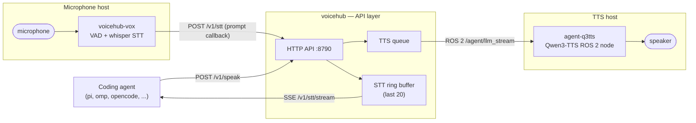

# VoiceHub

Agent-neutral API layer between coding agents and voice I/O. An agent POSTs
the text it wants spoken and receives recognized speech back over SSE;
microphone side and speaker side are separate, replaceable containers. Any
harness that can do HTTP works — pi, omp, opencode, … (build recipe for
agent extensions: `GET http://HOST:8790/integration`).



## Components

**`voicehub` — the API layer** (`hub/docker-compose.yml`). One
Python/aiohttp process holding both sides in memory: an outgoing TTS queue
(at-most-once, TTL 30 s) published onto ROS 2 — by default **from inside the
hub** (rclpy; topic, namespace and `ROS_DOMAIN_ID` via env) — and an
incoming STT ring buffer that is pushed to connected agents as SSE events,
with replay for reconnects (`Last-Event-ID`). Everything under `/v1/`
requires a bearer token.

**`voicehub-vox` — the ears** (`vox/docker-compose.yml`). The upstream
[vox](https://github.com/bob-ros2/vox) image plus one small custom handler:
microphone → VAD → whisper STT, then each finished utterance is POSTed to
the hub (`POST /v1/stt`, the "prompt callback") and a heartbeat marks the
chain alive. vox knows nothing beyond `VOICEHUB_URL`/`VOICEHUB_TOKEN`, so
it runs on any machine with a microphone and can be detached at any time.

**`agent-q3tts` — the voice** (external, untouched).
[bob_q3tts](https://github.com/bob-ros2/bob_q3tts): a Qwen3-TTS ROS 2 node
that subscribes to `/agent/llm_stream` and plays the synthesized speech.
VoiceHub never modifies or manages this container.

Optionally a fourth piece, **voicehub-edge** (`edge/`), joins when the hub
runs on a different machine than the speaker — see below.

## Split operation (optional)

- **Hub on a different server, q3tts stays separate:** in the hub set
  `VOICEHUB_ROS_TTS=0`, `VOICEHUB_BIND=0.0.0.0` (+TLS/token), and additionally
  start `edge/docker-compose.yml` on the TTS host (voicehub-edge fetches jobs
  via long-poll and publishes locally). Then 4 containers — only as far as the
  hosts are actually split.
- **Vox on a different host:** always works — set `VOICEHUB_URL`/`VOICEHUB_TOKEN`
  in its `.env`, done.
- DDS over LAN: the hub (host network, domain 55) also finds q3tts on another
  machine in the same network (multicast discovery); edge is the robust variant
  across network boundaries.

## Start

```sh
cd /path/to/voicehub
cp .env.example .env      # set VOICEHUB_TOKEN (openssl rand -hex 24)
docker compose -f hub/docker-compose.yml up -d --build
docker compose --env-file ../.env -f vox/docker-compose.yml up -d  # on the mic host
```


## Pitfalls
- vox: `restart: "no"` is intentional (dockerd-vs-logind race at boot;
  otherwise `/run/user/1000` ends up root-owned). The Pulse socket must exist
  before compose mounts it. Microphone is exclusive: never run two vox
  containers at once. Start manually after reboot.
- Hub/edge: UID 1000 + host network + `ipc: host` (FastRTPS shm discovery).
  The topic must stay absolute `/agent/llm_stream`
  (q3tts remap `text:=/agent/llm_stream`), QoS RELIABLE depth 10.
- Internal-ROS mode and voicehub-edge at the same time steal jobs from each
  other — enable exactly one of the two.
- Delivery: TTS is at-most-once; queue TTL 30 s, max `VOICEHUB_TTS_MAX` (100).


## Development

```sh
pip install -r requirements-dev.txt   # ruff, pytest, aiohttp
make lint                             # ruff check
make test                             # pytest tests (spins real hub processes)
```

## API

See `docs/API.md` (short reference), interactive: `GET /docs`,
OpenAPI: `GET /openapi.json`.

## License

Apache-2.0, see `LICENSE`. The vox and bob_q3tts images/containers are
separate upstream projects with their own licenses.
